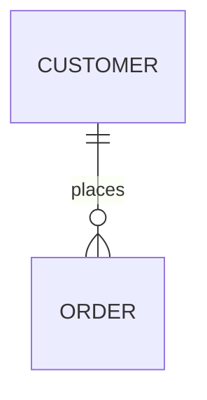

# opencode-markdown-extras

An [OpenCode 2](https://opencode.ai) terminal plugin with extra Markdown rendering for the
transcript, the port of
[pi-markdown-extras](https://github.com/justmytwospence/pi-plugins/tree/main/packages/pi-markdown-extras):

- **Class and ER diagrams** as Unicode box-drawing art through
  [grok-mermaid](https://github.com/xl0/grok-mermaid). OpenCode's built-in renderer already draws
  ```` ```mermaid ```` flowcharts, sequence, state, gantt, gitGraph and timeline diagrams; this adds
  the two kinds it shows as source, whether they arrive as ```` ```mermaid ```` with a `classDiagram`
  or `erDiagram` header or as a ```` ```classdiagram ```` / ```` ```erdiagram ```` dialect fence.
- **Dialect fences.** ```` ```statediagram ````, ```` ```statediagram-v2 ```` and
  ```` ```sequencediagram ```` fences become ```` ```mermaid ```` with their header line, so the
  built-in renderer draws them.
- **Admonitions.** GitHub admonitions (`> [!NOTE]`, `[!TIP]`, `[!IMPORTANT]`, `[!WARNING]`,
  `[!CAUTION]`) become a quote that starts with a bold label; a multi-line body is joined.
- **Circled numbers.** U+2460 to U+2473 are rewritten as `(1)` to `(20)`, which have the same width
  in every font.
- **Multi-line links.** A link label that spans lines is joined, so it reads and links as one.

Example (an illustration, not a screenshot):

~~~
> [!WARNING]
> The cache is cleared
> on every restart.


~~~

draws as

~~~
│ Warning: The cache is cleared on every restart.

┌──────────┐
│ CUSTOMER │
└─────┬────┘
      │
      │1 places 0..*
  ┌───────┐
  │ ORDER │
  └───────┘
~~~

## How it works

Diagrams use the plugin API: `context.markdown.registerCodeBlockRenderer` for the `classdiagram`,
`classdiagram-v2` and `erdiagram` languages returns a text renderable with the art, styled with
the theme's text colors. When grok-mermaid cannot parse the source, or the art is wider than the
terminal, the fence stays an ordinary code block. The plugin cannot register for `mermaid`
itself: OpenCode's built-in renderer owns that language and the host rejects a second renderer
for it, so class and ER fences are re-labelled to this plugin's languages before parsing.

The text transforms (admonitions, circled numbers, link labels, and the fence relabelling that
routes diagrams) have no API: OpenCode draws every message with OpenTUI's `MarkdownRenderable`,
so the plugin wraps that class's `updateBlocks`, which every content, streaming or style change
goes through, and hands it the transformed text. The result is cached per message, so unchanged
content costs nothing, and the wrapper calls whatever was installed before it, so it composes
with opencode-prose-width in either load order. Only what the terminal shows changes; the stored
message and the model context never do. `updateBlocks` is internal to OpenTUI, so a release that
renames it makes the plugin fail at load rather than misdraw. Tested with OpenCode 2.0.24.

Differences from pi-markdown-extras: the built-in mermaid renderer keeps every kind it draws
(grok-mermaid draws only class and ER diagrams here), the transforms also run while a message
streams, and a diagram that does not fit stays a code block instead of a framed source box.

## Install

Terminal-only: list it in `~/.config/opencode/cli.json`, pinned to a suite commit.

```json
{
  "plugins": [
    "opencode-markdown-extras@github:justmytwospence/opencode-plugins#<commit>::path:packages/opencode-markdown-extras"
  ]
}
```

`grok-mermaid` is the only runtime dependency; OpenCode installs it with the plugin. It is
imported lazily, and if it cannot be loaded every other feature still works. There are no
settings, commands, network calls or model requests.

## Development

Part of [opencode-plugins](https://github.com/justmytwospence/opencode-plugins); see its README.
The license carries the notice of [pi-cc-extensions](https://github.com/minuque/pi-cc-extensions),
which the transforms descend from.

```sh
npm ci && npm run check
```
